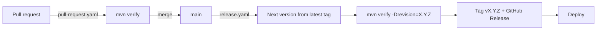

# 0016. Versioning and releases

- **Status:** Accepted
- **Date:** 2026-11-05
- **Amended:** 2026-11-10 (adopted tag-based releases; was Proposed)

## Context

Every merge to `main` is deployed to production. We need to know exactly which version is running,
what changed between two deployments, and that a version number is never reused or forgotten.
Bumping a version by hand in the poms is the step that gets forgotten.

## Decision

### Workflow

- **GitHub Flow:** short-lived feature branches, a pull request into `main`, and every merge to
  `main` is released and deployed. There is no `develop` branch; `main` is always what runs in
  production.

### Versions

- The version is the application's version, shared by the parent pom and every module through
  Maven's `${revision}` property.
- The poms default to `<revision>0.0.0-SNAPSHOT</revision>`, so local builds are visibly snapshots.
- **The git tag is the source of every release version.** Nobody edits a pom to release.
- Versions follow semantic versioning. The pipeline bumps the **patch** version by default;
  `#minor` or `#major` in the pull request title (which becomes the squash commit message) bumps
  that part instead:

|                    Change                    |  Marker  |    Example    |
|----------------------------------------------|----------|---------------|
| Bug fix, dependency upgrade, internal change | none     | 0.6.3 → 0.6.4 |
| New capability that doesn't break clients    | `#minor` | 0.6.3 → 0.7.0 |
| Breaking change to the API                   | `#major` | 0.6.3 → 1.0.0 |

- The **flatten plugin** writes installed and deployed poms with the real version instead of
  `${revision}`.

### Pipeline

- **`pull-request.yaml`** runs `mvn verify` on every pull request.
- **`release.yaml`** runs on every push to `main`: it finds the latest `v*` tag, computes the next
  version, builds and tests with `-Drevision=X.Y.Z`, tags the commit, creates a GitHub Release with
  generated notes, and deploys. Releases never run in parallel.
- A tag is created only after the build and tests pass.
- The running service reports its version at `/actuator/info` (through `build-info`).
- The first release tag, `v0.5.0`, was created by hand as the starting point.

## Consequences

- Every deployment has a unique, permanent version, and `git diff v0.6.3 v0.6.4` shows exactly what
  changed, poms included.
- GitHub Releases form a changelog of merged pull requests.
- Forgetting `#minor` releases a feature as a patch. That is harmless and can be corrected with the
  next merge.
- Pom changes are tracked through git history, not through the version number. The parent pom is
  used by this repository only, so it never needs a version of its own.
- Two quick merges are released one after the other, never with the same version.

## Alternatives considered

- **Git Flow (`develop`, release branches):** suited to teams bundling features into scheduled
  releases; overhead without benefit when every merge is deployed.
- **Editing the version in the poms by hand:** the step that gets forgotten, leading to reused
  versions.
- **Tagging by hand before each release:** possible, but a manual step in an otherwise automatic
  deployment.
- **release-please or semantic-release:** richer (changelog files, conventional commits), but more
  tooling than a single-person project needs. A sensible upgrade if the team grows.
- **A separately versioned, shared parent pom:** appropriate when several projects inherit from it;
  then every change to it needs a new version.

