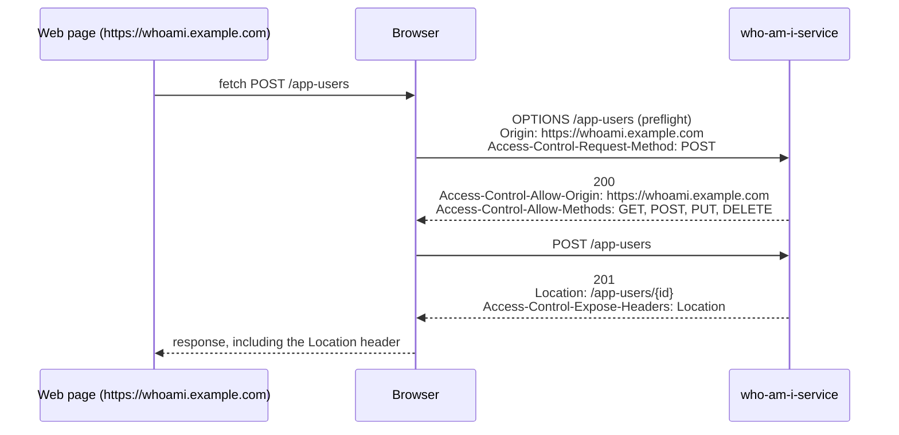
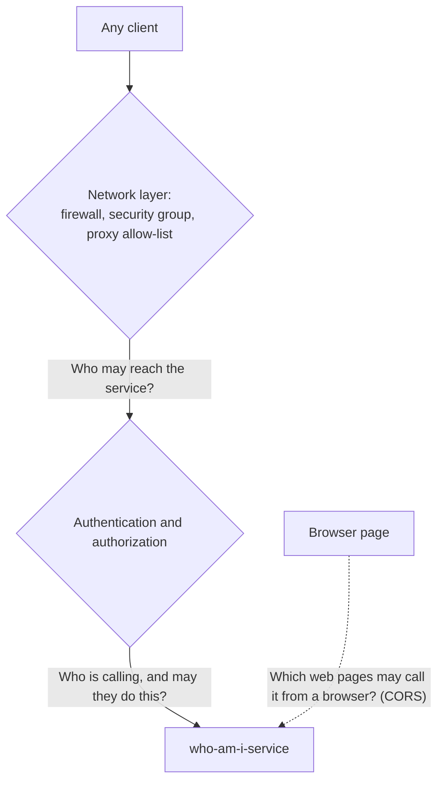

# 0018. Cross-origin requests (CORS)

- **Status:** Accepted
- **Date:** 2026-11-10

## Context

Browsers block a web page from calling an API on a different origin (scheme, host and port) unless
the API explicitly allows it. CORS is how the API says which pages may call it.

The first version of this service listed IP addresses of physical locations as "allowed origins",
intending to restrict where the API could be called from. That did not work, for two reasons:

- An origin is the address of the **web page** making the request (for example
  `https://whoami.example.com`), not the network the user is on. Bare IP addresses never match.
- CORS is enforced **by browsers only**. `curl`, Postman, scripts and other services ignore it
  entirely and can call the API from anywhere.

### How a browser call works



If the origin is not allowed, the browser stops after the preflight and the page receives an error.
The API itself never sees the actual request.

### What protects what



CORS answers only the last question. Restricting networks or callers belongs to the network layer
and to authentication.

## Decision

- **Allowed origins are configuration, not code.** They are listed per environment in
  `app.cors.allowed-origins`:

  ```yaml
  app:
    cors:
      allowed-origins: [ "http://localhost:3000" ]
  ```

  Deployed environments override it with the environment variable `APP_CORS_ALLOWED_ORIGINS`
  (comma-separated). When nothing is configured, the list is empty and no cross-origin browser
  calls are allowed.

- The remaining settings follow from the API contracts and are fixed in code (`web.cors.CorsConfig`):

|     Setting     |              Value              |                       Why                        |
|-----------------|---------------------------------|--------------------------------------------------|
| Allowed methods | `GET`, `POST`, `PUT`, `DELETE`  | The methods the contracts use                    |
| Allowed headers | `Authorization`, `Content-Type` | JSON bodies, and authentication once added       |
| Exposed headers | `Location`                      | So pages can read where a created resource lives |
| Credentials     | Not allowed                     | No cookie-based sessions                         |
| Max age         | 3600 seconds                    | Browsers cache the preflight for an hour         |

- **IP addresses, host names of physical locations, and any other network restrictions never
  appear in the application.** They belong to the infrastructure.
- If Spring Security is added, it must apply this configuration with
  `http.cors(Customizer.withDefaults())`; otherwise it rejects preflight requests first.

## Consequences

- Adding a frontend is a configuration change per environment, with no code change or release.
- An environment with no configured origins is safe by default: browsers cannot call it
  cross-origin, while non-browser clients are unaffected either way.
- CORS gives no protection against non-browser clients. Anything that must not be reachable needs
  network rules or authentication.
- No location-specific data is stored in the repository.

## Alternatives considered

- **IP addresses as allowed origins:** does not match how browsers send origins, and cannot
  restrict non-browser clients anyway.
- **Allowing every origin (`*`):** any website could call the API from its visitors' browsers.
- **Origins hard-coded in a class:** every new frontend or environment would need a code change and
  a release.

